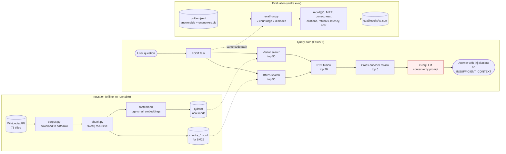
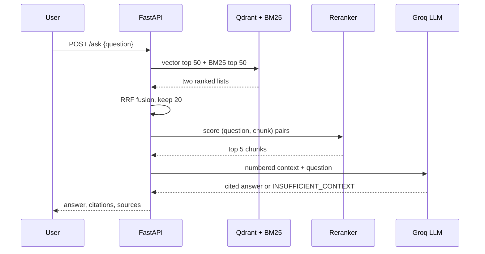

# RAG Retrieval Evaluation

Question answering over a Wikipedia subset (alpine skiing and mountaineering), comparing chunking strategies and retrieval modes with a golden set. Answers carry inline citations `[1][2]`, and the system refuses when the context is insufficient.


> **Status: working skeleton, evaluation not yet run.** The pipeline, API and evaluation script are written and the unit tests pass, but no evaluation run has been recorded, so this README reports **no result numbers**. See [Status and findings](#status-and-findings).

## Architecture



**Request flow**



## Design choices

| Choice | Why |
|---|---|
| Local Qdrant + fastembed (ONNX) | No Docker or GPU needed; light install |
| Chunk ids are content hashes, collection rebuilt on ingest | Ingestion is idempotent and re-runnable |
| Doc-level relevance for recall@5 / MRR | Comparable across chunking strategies |
| Refusal by prompt (`INSUFFICIENT_CONTEXT`) | Simplest; no score threshold to tune. Known weakness, see below |
| LLM-judge for correctness | Cheap; judge and generator are the same model, so it is biased |

## Results

**Not measured yet.** `make eval` writes `eval/results/<timestamp>.json` and prints one row per configuration (2 chunkings x 3 retrieval modes): recall@5, MRR, answer correctness, citation validity, false refusals, refusals on unanswerable questions, p50/p95 latency and cost per 1k requests. Real numbers will replace this section after the first run.

**Acceptance criteria status**
- [x] `make eval` is implemented (script written, not yet run)
- [ ] Hybrid + rerank beats vector-only on recall@5: unverified until a real run
- [ ] Unanswerable questions refused at least 80% of the time: unverified until a real run
- [ ] Airflow ingestion DAG: not built yet

## Status and findings

Checked on 2026-10-30:

- **Tests:** 3 unit tests pass (RRF fusion, chunk sizes, citation and refusal parsing). `ruff check` passes.
- **Corpus:** 74 of 75 titles downloaded, 1.6 MB of plain text (`Alpine Skiing at the Winter Olympics` was skipped as missing).
- **Not run:** the evaluation, the golden-set generation and the API under load. No latency or cost figure exists yet.
- **Golden set:** drafted by an LLM from sampled chunks plus 8 hand-written unanswerable questions. It must be reviewed by hand before any number is trusted.
- **Missing against the project goal:** Airflow ingestion DAG, Docker setup, Streamlit UI, RAGAS metrics, a golden set of 100+ questions.

## Quickstart (on a machine where installs are allowed)

```bash
cp .env.example .env          # add GROQ_API_KEY
make setup                    # venv + deps
make data                     # download corpus, build both indexes
make golden                   # draft eval/golden.jsonl, then review by hand
make eval                     # results table + eval/results/<ts>.json
make run                      # API on :8000
```

```bash
curl -s localhost:8000/ask -H 'content-type: application/json' \
  -d '{"question": "What is a crevasse?"}'
```

## Trade-offs and known limits

- Refusal relies on the model obeying the prompt. A retrieval-score threshold would be more robust.
- Same model generates and judges, which inflates `correct`. Use a different judge model for stronger claims.
- Golden set is small (38 questions) and LLM-drafted; hand-review it and grow it to 100+.
- Cost uses unverified per-token prices from `config.py`. Check Groq's pricing page.
- Not built yet: Airflow ingestion DAG, Streamlit UI, Docker, RAGAS metrics. A GitHub Actions workflow runs lint and the unit tests.

## Data

The corpus is downloaded from the Wikipedia API at setup time (`make data`) and is not stored in this repository. Wikipedia text is available under CC BY-SA; keep attribution if you redistribute it.

## Credits

Inspired by (read for ideas, no code copied): qdrant/qdrant-rag-eval, RahulModugula/athena, didorsi/docquery. Their licences were not checked, so treat this as inspiration only.
